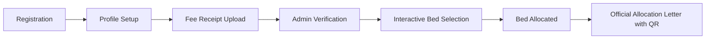

# 🏢 DORMIFY — University Hostel Admission & Allocation ERP

[](https://dormify-web.onrender.com/login)
[](https://dormify-ymt7.onrender.com/)
[](https://www.typescriptlang.org/)
[](https://reactjs.org/)
[](https://www.prisma.io/)
[](https://www.postgresql.org/)

> **Next-generation residential ERP for universities.** Transform chaotic hostel admissions, paper receipts, and spreadsheet double-bookings into an intuitive, real-time, interactive bed selection experience.

---

## 🌐 About & Live Deployments

**Dormify** digitizes the entire residential lifecycle of higher education institutions. Instead of long manual queues, opaque waitlists, and accidental overbookings, Dormify delivers a seamless self-service portal for students paired with a high-throughput administrative command center.

| Component | Live Deployment URL | Description |
| :--- | :--- | :--- |
| 🖥️ **Frontend Web App** | [https://dormify-web.onrender.com/login](https://dormify-web.onrender.com/login) | Student & Admin Portal with interactive floorplans |
| ⚙️ **Backend REST API** | [https://dormify-ymt7.onrender.com/](https://dormify-ymt7.onrender.com/) | Express + Prisma + PostgreSQL API engine |

---

## 💡 What Makes Dormify Special?

Hostel booking during university admissions is notorious for high concurrency surges, broken payment confirmations, and manual administrative overload. **Dormify solves this from the ground up:**

- 🎯 **Interactive Flight-Style Room Picking**: Students don't just get assigned an arbitrary room number. They explore an interactive floor plan (Block ➔ Floor ➔ Room ➔ Bed) with live occupancy indicators and select their preferred bed in real time.
- 🛡️ **Rock-Solid Concurrency Shield**: Powered by PostgreSQL row-level locks and strict Prisma composite constraints (`@@unique([bedId, academicYearId, status])`). If hundreds of students click the same corner bed at the exact same millisecond, only one transaction succeeds—with zero double allocations and clean `409 Conflict` resolution.
- ⚡ **Split-Screen Fee Verification**: Administrators review bank receipts side-by-side with student records, approving or rejecting with structured audit notes in seconds.
- 🖨️ **Official Institutional Allocation Letters**: Instantly renders official, print-ready PDF-style allocation letters complete with university branding, student roll data, allocation codes, and scannable QR verification stamps.
- 📊 **Executive Command Center**: Gives Wardens and Administrators real-time visibility into capacity utilization, branch-wise distribution, audit logs, and administrative overrides.

---

## 🔄 Student Journey



---

## ⚡ Superpowers & Features

### 1. 🗺️ Interactive Floorplan & Bed Matrix
- Visual mapping of Blocks (Cauvery, Vaigai, Ponni, Orchid, Rajam NRI, Birla), Floors, and Rooms.
- Real-time room status badges: `AVAILABLE`, `PARTIALLY_OCCUPIED`, `FULL`, `MAINTENANCE`, `RESERVED`.
- Live capacity counters that recalculate instantly as allocations happen.

### 2. 🔒 Atomic Concurrency & Race-Condition Defense
- Built-in transaction isolation prevents stale reads and duplicate bed claims.
- Validated with an automated multi-threaded concurrency test suite simulating peak admission traffic.

### 3. 💳 Smart Fee Review Desk
- Direct receipt image preview with zoom & pan inspection.
- One-click verification and timestamped audit logs.
- Rejection workflow with required remarks to notify students immediately.

### 4. 🏛️ Warden Administration Suite
- **Metrics Dashboard**: Total students, verified cohort, pending queue, and bed occupancy percentage.
- **Directory**: Instant search, department filtering, and pagination.
- **Hostel Hierarchy Manager**: Create and manage Blocks, Floors, Rooms, and individual Beds.
- **Audit Trails & Overrides**: Full accountability for administrative adjustments and emergency reassignments.

---

## 🔑 Demo Accounts (Try It Live!)

Use these pre-seeded demo accounts to explore different roles on [dormify-web.onrender.com](https://dormify-web.onrender.com/login):

| Role | Email | Password | Context / Persona |
| :--- | :--- | :--- | :--- |
| 👑 **Chief Warden** | `warden@dormify.edu` | `Password123!` | Full oversight, analytics, and hostel structure management |
| 🛡️ **Administrator** | `admin@dormify.edu` | `Password123!` | Fee review queue, student verification & allocation overrides |
| 🎓 **Student (Allocated)** | `alex.rivera@student.dormify.edu` | `Password123!` | Has completed flow & holds official letter (Orchid Block) |
| 🎓 **Student (Ready to Pick)** | `kavya.nair@student.dormify.edu` | `Password123!` | Fee verified — test the interactive room/bed selection! |
| 🎓 **Student (Pending Review)** | `marcus.vance@student.dormify.edu` | `Password123!` | Fee submitted — visible in the Admin verification queue |

---

## 🛠️ Tech Stack

```
Frontend               Backend                Database & Infra
┌─────────────────┐   ┌─────────────────┐    ┌─────────────────┐
│ • React 18      │   │ • Node.js       │    │ • PostgreSQL    │
│ • TypeScript    │──▶│ • Express.js    │───▶│ • Prisma ORM    │
│ • Vite          │   │ • TypeScript    │    │ • Multer        │
│ • Lucide Icons  │   │ • JWT & Bcrypt  │    │ • Render Cloud  │
│ • CSS System    │   │ • Row-Level Tx  │    │                 │
└─────────────────┘   └─────────────────┘    └─────────────────┘
```

---

## 🚀 Local Development Setup

### 1. Prerequisites
- **Node.js** (v18+)
- **PostgreSQL** instance

### 2. Clone & Configure Environment
```bash
git clone https://github.com/Tharnikaa/Dormify.git
cd Dormify

# Copy environment templates
cp .env.example .env
cp .env.example backend/.env
```

### 3. Backend Setup
```bash
cd backend
npm install
npx prisma generate
npm run dev
```
*Backend runs on `http://localhost:5000` (or `PORT` specified in `.env`).*

### 4. Frontend Setup
```bash
cd ../frontend
npm install
npm run dev
```
*Frontend runs on `http://localhost:5173`.*

### 5. Run Concurrency Test Suite
Simulate parallel booking collisions to verify database locking:
```bash
cd backend
npm run test:concurrency
```

---

## 📄 License
This project is developed for institutional hostel automation. All rights reserved.
